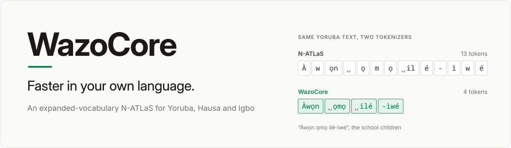
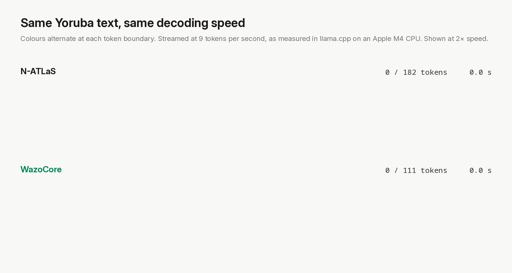
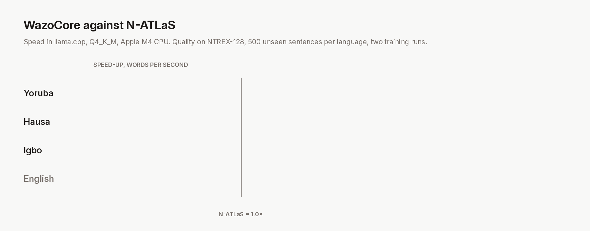

<sub>The same FLORES-200 passage in Yoruba, Hausa and Igbo. Replay of real tokenisations, streamed at the decode speed measured in llama.cpp on an Apple M4 CPU (9 tokens per second), shown at 2× speed. Text colour alternates at each token boundary.</sub>

A version of N-ATLaS, Nigeria's open language model, that reads and writes Yoruba, Hausa and Igbo in 1.4 to 1.6 times fewer tokens. It drops into llama.cpp, LM Studio and any OpenAI-compatible stack as a standard GGUF, and generates these languages 1.55 to 1.64 times faster on an ordinary laptop. That speed has a cost in the 4-bit file we ship: about three chrF++ points in Igbo and one in Hausa (one point and half a point at full precision). Yoruba is equal or slightly better.

- **Faster replies**: the same answer arrives in 61 to 65% of the time, because each token now carries more of a word. Decode speed in tokens per second is about the same for both models, so the gain comes from the token count and not from the machine.
- **Lower serving cost**: a reply costs a third fewer tokens. A 5,000-word health leaflet written in Yoruba falls from about 14,600 tokens to 9,950.
- **More in context**: N-ATLaS's 8,092-token window holds 8.8 pages of Yoruba instead of 5.6.
- **Drop-in**: same file format, same chat template, same API. All 128,256 original tokens keep their ids and their exact embeddings, and training is anchored to the original model's predictions.



WazoCore continues N-ATLaS's byte-level BPE with 15,000 merges learned jointly on Yoruba, Hausa and Igbo, rejecting any merge that would split a UTF-8 character. New input embeddings start as the mean of their original pieces and output embeddings as the byte-length-weighted mean. Training updates only the new rows and the outer four of 32 transformer layers, on N-ATLaS's own translations re-tokenised into the new vocabulary, with a KL anchor to the frozen original on the old segmentation and a gradient mask that leaves every original row exact. It takes about 40 minutes on one A100.

## Benchmarks

Speed is words per second from a paired benchmark in llama.cpp (Q4_K_M, Apple M4 CPU, 4 threads, 20 translations per language, both models answering each sentence in turn; one stalled Yoruba request is excluded and reported). Quality is chrF++ against human references with 95% paired-bootstrap intervals, on NTREX-128 (500 news sentences per language, never used in development) and FLORES-200, across two independent training runs. Pooled over both test sets and both runs, the change from the original is +0.6 for Yoruba (−0.1, +1.2), −0.6 for Hausa (−1.1, −0.0) and −1.1 for Igbo (−1.7, −0.5) at full precision. The shipped Q4_K_M files, compared with each other on 250 NTREX-128 sentences, give +0.6 (−0.7, +1.8), −1.2 (−2.0, −0.3) and −2.9 (−4.3, −1.6): WazoCore loses more than the original when quantised to 4 bits. A control run with the same recipe and no new tokens separates the effect of the vocabulary from the effect of training.

Full tables, raw results and the experiments we rejected are in [docs/METHOD.md](docs/METHOD.md).

## Get started

Serve the GGUF with llama.cpp (or load it in LM Studio and start its server):

```sh
llama-server -m WazoCore-8B.Q4_K_M.gguf -c 4096 --port 8080
```

Call it with any OpenAI client:

```python
from openai import OpenAI

client = OpenAI(base_url="http://localhost:8080/v1", api_key="local")
reply = client.chat.completions.create(
    model="wazocore",
    messages=[{"role": "user", "content": "Translate into Hausa: The clinic opens at eight in the morning."}],
)
print(reply.choices[0].message.content)
# Asibitin yana bude daga karfe takwas na safe.
```

It runs offline on a laptop with 8 GB of memory or more.

## Guides

- [Method and results](docs/METHOD.md): the recipe, validated benchmarks, where the Igbo gap comes from, the version history, and why on-policy distillation was rejected.
- [Training on a cloud GPU](docs/cloud-vx.md): the four pipelines, the upload, run times, outputs and known pitfalls.
- [Model card](release/MODEL_CARD.md): intended use, results, limitations and licence terms.
- [Blind A/B tester kit](tester-kit/): the guide, tasks and feedback form for native-speaker evaluation.
- [Contributing](CONTRIBUTING.md): setup, tests, adding a language and engineering standards.

## Build for your language

The toolkit that produced WazoCore reproduces it end to end, and adapts to a new language by changing two tables and the input text.

| | Use WazoCore | Build your own |
|---|---|---|
| What you get | Yoruba, Hausa and Igbo, ready to serve | An expanded N-ATLaS for your languages or domain |
| What you need | llama.cpp or LM Studio | Python 3.11, uv, N-ATLaS access, one 80 GB GPU |
| Time | Minutes | A laptop for the tokenizer, about 3 GPU hours for training and evaluation |
| Evidence | This repository's results | The same benchmarks, run on your model |

```sh
git clone https://github.com/Adeniyikayodee/wazocore.git && cd wazocore
uv run --project wazocore --group ref pytest wazocore/tests
uv run --project wazocore --group ref python -m wazocore.vocab_expand build --out data/models/n-atlas-vx2
scripts/cloud_vx_upload.sh HOST PORT        # then run cloud_vx_pod.sh on the GPU host
scripts/paired_vx.sh LABEL 4 20 0 path/to/model.gguf
```

## Roadmap

- **Close the Igbo and Hausa gaps** without giving back speed: first in the quantised file, then with the next training recipe ([METHOD.md](docs/METHOD.md), section 8).
- **More languages**: Nigerian Pidgin and Fulfulde next, then other African languages that pay the same token tax.
- **Distribution**: Ollama and the LM Studio catalogue, and a public technical report.
- **Upstream**: future N-ATLaS releases that ship with an expanded vocabulary, so every developer gets the speed-up by default.

## Citation

```bibtex
@misc{adeniyi2026wazocore,
  title        = {WazoCore: In-Place Vocabulary Expansion for Yoruba, Hausa and Igbo on N-ATLaS},
  author       = {Adeniyi, Kayode},
  year         = {2026},
  howpublished = {\url{https://github.com/Adeniyikayodee/wazocore}}
}
```

## Licence and acknowledgements

Model weights derived from N-ATLaS are released under the N-ATLaS Open-Source Research and Innovation License, which requires attribution, the same licence for derivatives, and a name ending in "Powered by Awarri."; see the [model card](release/MODEL_CARD.md).

> N-ATLaS is an initiative of the Federal Ministry of Communications, Innovation and Digital Economy, and powered by Awarri Technologies.

Built on N-ATLaS by Awarri Technologies and the Federal Ministry of Communications, Innovation and Digital Economy; FLORES-200 and NTREX-128; Wikipedia in Yoruba, Hausa and Igbo; llama.cpp; and published work on vocabulary expansion (arXiv 2607.15232), low-budget adaptation (arXiv 2406.11477) and embedding initialisation (arXiv 2608.03494).
